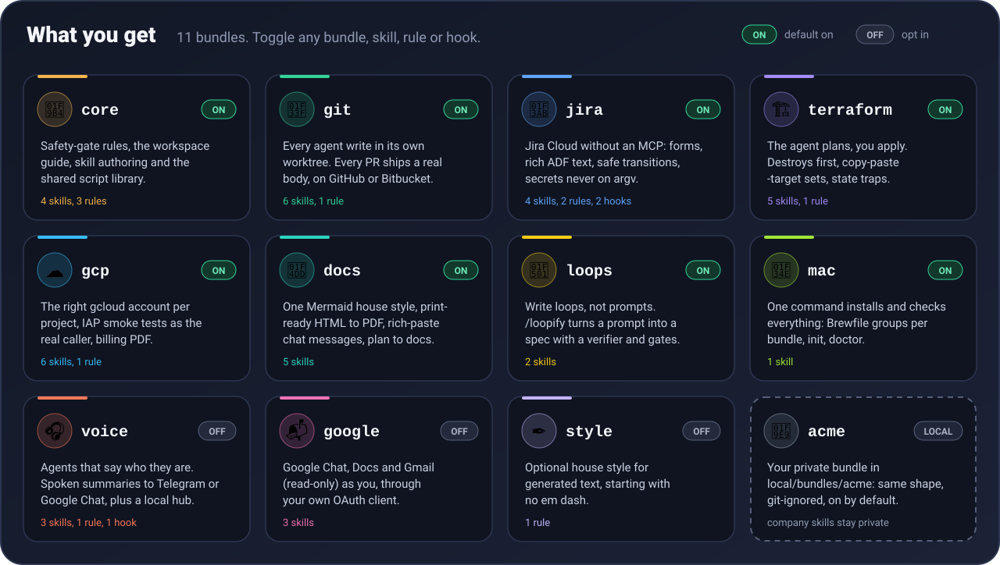
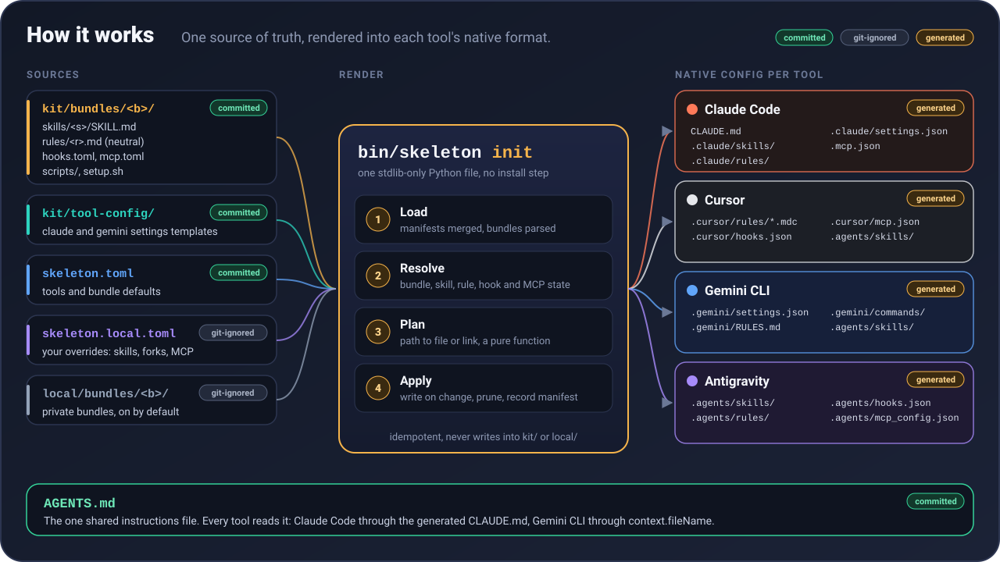
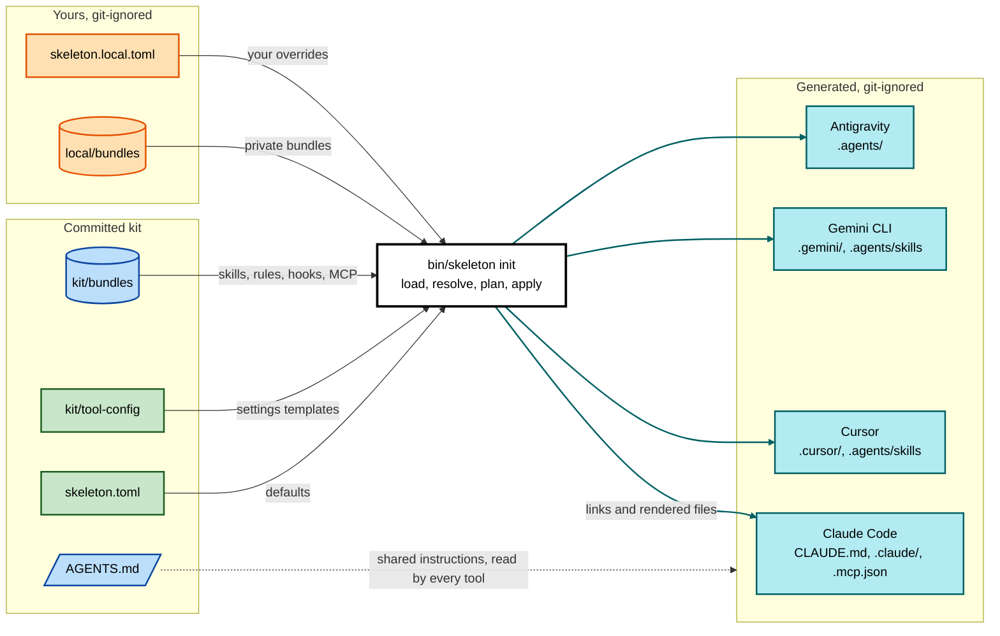
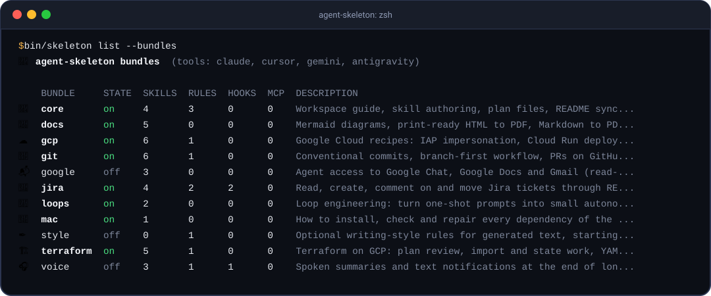
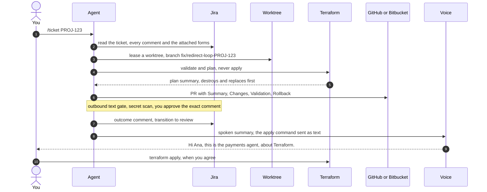
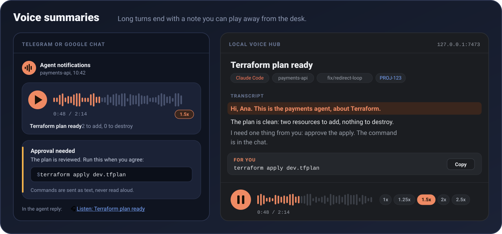

<div align="center">



**One kit of skills, rules, hooks and MCP servers. Native config for every AI coding tool. Toggle anything.**

[](docs/getting-started.md)
[](docs/tool-support.md#claude-code)
[](docs/tool-support.md#cursor)
[](docs/tool-support.md#gemini-cli)
[](docs/tool-support.md#antigravity)
<br>
[](docs/decisions.md#d1-one-cli-file-stdlib-only)
[](tests/)
[](LICENSE)

[Quick start](#-quick-start) ·
[Bundles](#-what-you-get) ·
[How it works](#-how-it-works) ·
[Customize](#-customize) ·
[Safety gates](#-safety-gates) ·
[Docs](docs/README.md)

</div>

---

## 🤔 Why

- **Every AI coding tool wants its own config.** Claude Code reads `.claude/`, Cursor
  `.cursor/rules/*.mdc`, Gemini CLI `.gemini/settings.json`, Antigravity `.agents/`.
- **So you copy the same skill four times,** tweak one copy, forget the others, and the
  agents slowly drift apart on what "safe" and "done" mean.
- **agent-skeleton keeps one source** (`kit/bundles/`) and renders it into each tool's
  native format with one command. Edit once, run `bin/skeleton init`, every tool agrees.

## 📦 What you get



| | Bundle | What it gives your agents | Default | Docs |
|---|---|---|:---:|---|
| 🦴 | **core** | The safety-gate rules, a workspace guide, skill authoring, plan files and the shared script library (secret scan, config reader, curl without secrets on argv). | ✅ on | [core](docs/bundles/core.md) |
| 🌿 | **git** | Every agent write happens in its own worktree, and every PR ships with a real Summary / Changes / Validation / Rollback body, on GitHub or Bitbucket. | ✅ on | [git](docs/bundles/git.md) |
| 🎫 | **jira** | Jira Cloud from the terminal without an MCP: full ticket reads including attached forms (injected by a prompt hook, as untrusted data), Markdown to rich ADF (tables, panels, mentions), safe transitions (never Done by cancelling), secrets never on argv. | ✅ on | [jira](docs/bundles/jira.md) |
| 🏗️ | **terraform** | *The agent plans, you apply.* Plan summaries with destroys and replaces first, copy-paste `-target` sets, import and state traps, a YAML-settings template. | ✅ on | [terraform](docs/bundles/terraform.md) |
| ☁️ | **gcp** | The right `gcloud` account per project, IAP smoke tests as the real caller, Cloud Run deploy checks, and a self-checking billing report PDF. | ✅ on | [gcp](docs/bundles/gcp.md) |
| 📝 | **docs** | One Mermaid house style with templates, print-ready HTML to PDF, rich-paste chat messages, and `/docs-plan-to-docs`. | ✅ on | [docs](docs/bundles/docs.md) |
| 🔁 | **loops** | *Write loops, not prompts.* `/loopify` turns a prompt into a loop spec with a separate verifier, `STATE.md` and human gates. | ✅ on | [loops](docs/bundles/loops.md) |
| 🍎 | **mac** | One command installs and checks everything: Brewfile groups per enabled bundle, then `init` and `doctor`. | ✅ on | [mac](docs/bundles/mac.md) |
| 🎧 | **voice** | Agents that say who they are (*"Hi Ana, this is the payments agent, about Terraform."*), spoken summaries on Telegram or Google Chat, a Stop hook across all four tools, a local voice hub. | ⬜ off | [voice](docs/bundles/voice.md) |
| 📬 | **google** | Google Chat, Docs and Gmail (read-only) as you, through your own OAuth client on a loopback login, tokens at mode 0600. | ⬜ off | [google](docs/bundles/google.md) |
| ✒️ | **style** | Optional house style for generated text, starting with "no em dash". | ⬜ off | [style](docs/bundles/style.md) |
| 🧩 | **your own** | Drop a private bundle in `local/bundles/<name>/` (same shape, git-ignored, on by default). | ✅ on | [customization](docs/customization.md#private-bundles-localbundlesb) |

All bundles: [docs/bundles/](docs/bundles/README.md).

## 🔧 How it works





- **Skills are symlinks** (the format is the same everywhere); **rules, hooks, MCP and
  settings are rendered** per tool, because each one spells them differently.
- **`init` is idempotent**: it writes only what changed, prunes what you turned off, and
  never touches `kit/`, `local/` or files it did not create.
- **Everything generated is git-ignored.** Your clone stays a clean kit; your machine gets
  the native files. Details: [architecture](docs/architecture.md).

## 🚀 Quick start

```bash
git clone https://github.com/<you>/agent-skeleton.git ~/code/agent-skeleton && cd ~/code/agent-skeleton
bin/install-mac.sh        # Xcode tools, Homebrew, the Brewfile groups of your bundles, then init + doctor
bin/skeleton init         # re-render after any change (safe to run again and again)
claude                    # or open the folder in Cursor, Gemini CLI or Antigravity
```

A fresh render, then a second one that has nothing to do:

```text
✅ **init** 33 skills, 8 rules, 2 hooks, 0 MCP servers for claude, cursor, gemini, antigravity (100 written, 0 pruned, 0 skipped)
✅ **init** 33 skills, 8 rules, 2 hooks, 0 MCP servers for claude, cursor, gemini, antigravity (0 written, 0 pruned, 0 skipped)
```

> [!TIP]
> **Cursor users:** turn off *Settings > Rules > Include third-party plugins, skills and
> other configs*. Otherwise Cursor also loads `.claude/` and every skill shows up twice.
> `bin/skeleton doctor` reminds you.

Not on a Mac? Install `git`, `python3` (3.11 or newer) and `curl` with your package
manager, then run `bin/skeleton init`. Full walkthrough: [getting started](docs/getting-started.md).

## 🔘 Toggle anything

Bundles, single skills, rules and hooks all have an on/off switch.



```console
$ bin/skeleton list --bundles
🦴 agent-skeleton bundles  (tools: claude, cursor, gemini, antigravity)

    BUNDLE     STATE  SKILLS  RULES  HOOKS  MCP  DESCRIPTION
🦴  core       on     4       3      0      0    Workspace guide, skill authoring, plan files, README sync...
📝  docs       on     5       0      0      0    Mermaid diagrams, print-ready HTML to PDF, Markdown to PD...
☁️  gcp        on     6       1      0      0    Google Cloud recipes: IAP impersonation, Cloud Run deploy...
🌿  git        on     6       1      0      0    Conventional commits, branch-first workflow, PRs on GitHu...
📬  google     off    3       0      0      0    Agent access to Google Chat, Google Docs and Gmail (read-...
🎫  jira       on     4       2      2      0    Read, create, comment on and move Jira tickets through RE...
🔁  loops      on     2       0      0      0    Loop engineering: turn one-shot prompts into small autono...
🍎  mac        on     1       0      0      0    How to install, check and repair every dependency of the ...
✒️  style      off    0       1      0      0    Optional writing-style rules for generated text, starting...
🏗️  terraform  on     5       1      0      0    Terraform on GCP: plan review, import and state work, YAM...
🎧  voice      off    3       1      1      0    Spoken summaries and text notifications at the end of lon...

$ bin/skeleton enable voice
✅ **voice** (bundle) enabled, workspace re-rendered
$ bin/skeleton disable terraform-plan-review
✅ **terraform-plan-review** (skill) disabled, workspace re-rendered
```

<details>
<summary><b>Full <code>bin/skeleton list</code> output (bundles and every skill)</b></summary>

```text
🦴 agent-skeleton bundles  (tools: claude, cursor, gemini, antigravity)

    BUNDLE     STATE  SKILLS  RULES  HOOKS  MCP  DESCRIPTION
🦴  core       on     4       3      0      0    Workspace guide, skill authoring, plan files, README sync...
📝  docs       on     5       0      0      0    Mermaid diagrams, print-ready HTML to PDF, Markdown to PD...
☁️  gcp        on     6       1      0      0    Google Cloud recipes: IAP impersonation, Cloud Run deploy...
🌿  git        on     6       1      0      0    Conventional commits, branch-first workflow, PRs on GitHu...
📬  google     off    3       0      0      0    Agent access to Google Chat, Google Docs and Gmail (read-...
🎫  jira       on     4       2      2      0    Read, create, comment on and move Jira tickets through RE...
🔁  loops      on     2       0      0      0    Loop engineering: turn one-shot prompts into small autono...
🍎  mac        on     1       0      0      0    How to install, check and repair every dependency of the ...
✒️  style      off    0       1      0      0    Optional writing-style rules for generated text, starting...
🏗️  terraform  on     5       1      0      0    Terraform on GCP: plan review, import and state work, YAM...
🎧  voice      off    3       1      1      0    Spoken summaries and text notifications at the end of lon...

🧩 skills

    BUNDLE     SKILL                        STATE  NOTES
🦴  core       plan-files                   on     
🦴  core       readme-sync                  on     
🦴  core       skill-authoring              on     
🦴  core       workspace-guide              on     
📝  docs       chat-rich-message            on     
📝  docs       docs-markdown-pdf-vscode     on     
📝  docs       docs-mermaid-diagrams        on     
📝  docs       docs-plan-to-docs            on     user-invocable only
📝  docs       docs-print-ready-pdf         on     
☁️  gcp        gcp-billing-report           on     
☁️  gcp        gcp-cloud-run-deploy-verify  on     
☁️  gcp        gcp-cloudsql-data-api        on     
☁️  gcp        gcp-iap-impersonation        on     
☁️  gcp        gcp-identity-routing         on     
☁️  gcp        gcp-oauth-client-setup       on     
🌿  git        git-branch-pr-workflow       on     
🌿  git        git-conventional-commits     on     
🌿  git        git-pr-bitbucket             on     
🌿  git        git-pr-github                on     
🌿  git        git-worktrees                on     
🌿  git        worktree                     on     user-invocable only
📬  google     gmail-access                 off    
📬  google     google-chat-access           off    
📬  google     google-docs-access           off    
🎫  jira       devops-ticket-workflow       on     
🎫  jira       jira-board-config            on     
🎫  jira       jira-tickets                 on     
🎫  jira       ticket                       on     user-invocable only
🔁  loops      loop-engineering             on     
🔁  loops      loopify                      on     user-invocable only
🍎  mac        mac-setup                    on     
🏗️  terraform  iac-docs-maintenance         on     
🏗️  terraform  terraform-gcp                on     
🏗️  terraform  terraform-import-and-state   on     
🏗️  terraform  terraform-plan-review        on     
🏗️  terraform  terraform-yaml-settings      on     
🎧  voice      notify                       off    
🎧  voice      voice-hub                    off    
🎧  voice      voice-summary                off    

Toggle with: bin/skeleton enable|disable <bundle|skill|rule|hook>
```

</details>

## 🎨 Customize

Your changes live in `skeleton.local.toml` (git-ignored), never in the committed files.
`enable` and `disable` edit it for you and keep your comments; this is everything it can do:

```toml
# skeleton.local.toml
tools = ["claude", "cursor"]          # render only the tools you use; the rest is pruned

[user]
name = "Ana"                          # voice greetings, PR templates
language = "en"                       # reply language hint and default TTS language

[bundles]
voice = true                          # turn a whole bundle on or off
gcp = false

[skills]
"terraform-plan-review" = false       # one skill off, whatever its bundle says
"loopify" = { invocation = "user" }   # slash command only (rendered copy, kit untouched)

[overrides]
"jira-tickets" = "~/my-skills/jira-tickets"   # your fork replaces the kit skill

[mcp.voice-hub]                       # MCP servers are opt-in and machine-local
command = "python3"
args = ["${SKELETON_ROOT}/tools/voice-hub/bin/avh", "mcp"]
```

**Private company bundles.** A bundle under `local/bundles/<name>/` has the same shape as
a kit bundle, is git-ignored, and is on by default. Keep your team's skills in their own
private repository and clone it there:

```bash
git clone git@github.com:acme/agent-bundle.git local/bundles/acme
bin/skeleton init
```

Every key, the bundle contract and the hook script contract: [customization](docs/customization.md).

## 📅 A day with agent-skeleton



## 🚦 Safety gates

Gates are rules shipped with their bundles. When one applies, it **wins over every
instruction to act autonomously**, and an approval covers only the exact action approved.

| | Gate | Bundle | The agent does freely | Needs your explicit yes |
|---|---|---|---|---|
| 🏗️ | `terraform-apply-requires-approval` | terraform | `init`, `validate`, `fmt`, `plan`, plan summaries | `apply`, `destroy`, state rewrites |
| 🗄️ | `database-mutation-requires-approval` | gcp | read-only `SELECT`, listing metadata | `INSERT`, `UPDATE`, `DELETE`, any DDL |
| ✉️ | `outbound-text-safety` | jira | drafting, secret scan with `text-guard.sh` | sending text to a ticket, PR or chat |
| 🌿 | `worktree-for-project-writes` | git | reading the shared checkout | any write: only from its own worktree and branch |
| ⛔ | `no-broad-process-kill` | core | stopping the PIDs it started | never `pkill` / `killall` by pattern |
| 🔐 | `permission-prompt-hygiene` | core | batching prompted commands into one approval | never disguising a command to dodge a prompt |

Behind the rules: the Claude Code settings template denies `terraform apply`, force
pushes, hard resets and `rm -rf`; the text guard blocks secrets before they leave the
machine (exit 2); scripts never take secrets on the command line. See
[agent-safety-gates](kit/bundles/core/rules/agent-safety-gates.md).

## 🧰 Tool support matrix

| What | Claude Code | Cursor | Gemini CLI | Antigravity |
|---|---|---|---|---|
| Instructions | `CLAUDE.md` (`@AGENTS.md`) | `AGENTS.md` | `AGENTS.md` via `context.fileName` | `AGENTS.md` |
| Skills | `.claude/skills/` | `.agents/skills/` | `.agents/skills/` | `.agents/skills/` |
| Rules | `.claude/rules/*.md` (`paths:`) | `.cursor/rules/*.mdc` | `.gemini/RULES.md` | `.agents/rules/*.md` (`trigger:`) |
| Slash commands | user-invocable skills | user-invocable skills | `.gemini/commands/*.toml` | every skill |
| Hooks | `.claude/settings.json` | `.cursor/hooks.json` | `.gemini/settings.json` | `.agents/hooks.json` |
| MCP | `.mcp.json` | `.cursor/mcp.json` | `.gemini/settings.json` | `.agents/mcp_config.json` |
| Disabled skills | `skillOverrides: off` | not linked | `skills.disabled` | not linked |

Hook event mapping, rule formats and per-tool quirks: [tool support](docs/tool-support.md).

## 🎧 Voice summaries



Turn on the `voice` bundle and long, complex or decision-shaped turns end with a note you
can play away from the desk:

- **Agents say who they are.** The script, not the agent, writes the opening line from the
  repository you stand in: *"Hi Ana, this is the payments agent, about Terraform."* Several
  agents with the same voice stay distinguishable.
- **Commands are never read aloud.** A fenced block becomes "The command is in the chat",
  and the command itself goes out as text you can copy.
- **Free and offline** with the macOS `say` voice, or Google Chirp 3 HD voices with an API
  key (the free tier covers about a million characters a month). English or Spanish.
- **Delivered to Telegram** (a voice bubble with a speed control) **or Google Chat**.
- **A Stop hook for all four tools** that will not let a qualifying turn end until a note
  was actually delivered. Inert until you configure a channel; `no audio` skips one turn.
- **A local voice hub** (optional): history, a 1x to 2.5x player with a live transcript,
  an MCP inline player, and your phone over Tailscale if you want it.

```bash
bin/skeleton enable voice && bin/skeleton setup voice     # about ten minutes, once
```

Details: [voice](docs/bundles/voice.md) and [voice hub](tools/voice-hub/README.md).

## ❓ FAQ

<details>
<summary><b>Does it touch my user-level config in <code>~</code>?</b></summary>

No. `bin/skeleton init` writes only generated paths inside the repository (listed in
`.skeleton/generated.json`), skips any file it did not create unless you pass `--force`,
and never writes into `kit/` or `local/`. Personal Claude Code settings belong in
`.claude/settings.local.json`, which is never generated.
</details>

<details>
<summary><b>Why not just symlink one folder into all four tools?</b></summary>

Skills are symlinked, because their format is shared. Rules, hooks, MCP and settings are
not: each tool has its own frontmatter, event names, matcher syntax and variable syntax
(`${VAR}` versus `${env:VAR}`, seconds versus milliseconds). A shared file would be wrong
for at least three of them. See [tool support](docs/tool-support.md).
</details>

<details>
<summary><b>I only use one or two of the tools.</b></summary>

Set `tools = ["claude", "cursor"]` in `skeleton.local.toml` and run `bin/skeleton init`.
The other tools' generated files are pruned.
</details>

<details>
<summary><b>Every skill shows up twice in Cursor.</b></summary>

Cursor's "Include third-party plugins, skills and other configs" setting is on, so it also
reads `.claude/`. Turn it off under Settings > Rules.
</details>

<details>
<summary><b>Does anything get sent without me asking?</b></summary>

No. Every script that talks to a service needs an explicit command, most have
`--dry-run`, the Stop hook is inert until a channel is configured, and outbound text
passes the secret scan and your approval first. Tests never touch the network.
</details>

<details>
<summary><b>What does it need installed?</b></summary>

`bin/skeleton` needs Python 3.11 or newer and nothing else (no pip, no PyYAML). If your
`python3` is older (macOS ships 3.9), it re-executes itself with the newest `python3.X`
it finds. Each bundle lists its own tools; `bin/skeleton doctor` checks them.
</details>

<details>
<summary><b>Does it work on Linux?</b></summary>

Best effort: the CLI, the renderers and the test suite run on Linux (CI covers
`ubuntu-latest`). The installer and the `mac` bundle are macOS only; install the
dependencies with your package manager instead.
</details>

<details>
<summary><b>How do I keep company-specific skills out of a public fork?</b></summary>

Put them in a private bundle under `local/bundles/<name>/` (git-ignored, discovered
automatically), ideally a clone of a private repository. Jira board configs go in
`local/bundles/<name>/jira-boards/` or `~/.config/agent-skeleton/jira-boards/`.
</details>

## 🧭 Roadmap

- [ ] Plugin marketplaces: publish each bundle as a Claude Code and Cursor plugin
- [ ] Setup wizards for every bundle (today: `jira`, `voice`, `google`)
- [ ] CI that runs `bin/skeleton check` on pull requests of forks and private bundles
- [ ] A Linux installer next to `bin/install-mac.sh`
- [ ] More bundles: Kubernetes, AWS, GitHub Actions

## 🤝 Contributing

```bash
bin/skeleton new-skill <bundle> <name>   # scaffold kit/bundles/<bundle>/skills/<name>/SKILL.md
bin/skeleton check                       # lint bundles, skills, rules, hooks and text
bin/skeleton test                        # the full test suite, offline
```

Read [CONTRIBUTING.md](CONTRIBUTING.md) first; security reports go through
[SECURITY.md](SECURITY.md). Design records live in [docs/decisions.md](docs/decisions.md).

## 📄 License

[MIT](LICENSE), by the agent-skeleton contributors.
