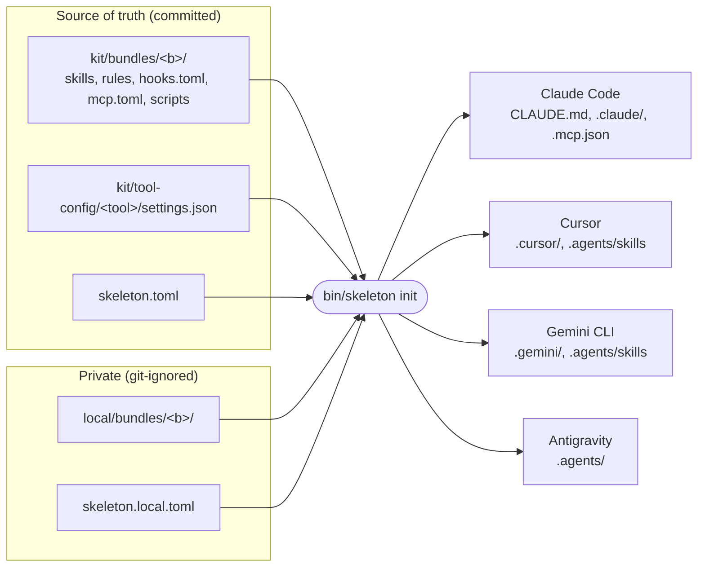

# Architecture

## One source, many renderings

- `AGENTS.md` is a real, committed file and the only shared instructions file. All four
  tools read it (Claude Code through the generated `CLAUDE.md`, which contains
  `@AGENTS.md`; Gemini CLI through `context.fileName`).
- Everything a tool reads besides `AGENTS.md` is **generated** and git-ignored. Formats
  that are identical across tools are symlinks (skills); formats that differ are
  rendered files (rules, hooks, MCP, settings).
- No config file is ever shared between two tools. Claude Code and Gemini CLI both use a
  `hooks` key with different event names and field semantics, so each gets its own file.

## The render pipeline

`bin/skeleton` (one stdlib-only Python file) runs four stages:

1. **Load**: `skeleton.toml` deep-merged with `skeleton.local.toml`; every bundle under
   `kit/bundles/` and `local/bundles/` (`bundle.toml`, `skills/*/SKILL.md`,
   `rules/*.md`, `hooks.toml`, `mcp.toml`). Frontmatter is read by a small parser for the
   YAML subset the kit uses, so there is no PyYAML dependency.
2. **Resolve**: bundle state (`[bundles]`, else `default_enabled`; local bundles default
   on), then per skill, rule, hook and MCP server (an explicit entry wins over the bundle
   state), invocation overrides, skill overrides (user forks), the tool list.
3. **Plan**: a map `relative path -> (file, content) | (link, target)`. Pure function of
   the resolved state; this is what `init --check` and `doctor` compare with the disk.
4. **Apply**: write files only when the content changes, re-point links only when the
   target changes, prune what the previous run generated and this run did not, sweep the
   generated directories for leftovers, remove generated directories left empty, then
   record every generated path in `.skeleton/generated.json`.

Because writes are skipped when nothing changed, two consecutive runs leave the tree
byte-identical, including timestamps.

## Ownership and safety

- `init` only touches generated paths and never writes into `kit/` or `local/`.
- A path that exists but was not generated (not in the manifest, no marker, not a link
  into the kit) is skipped with a warning; `--force` overwrites it.
- `.claude/settings.local.json`, user-level config in `~` and anything else in the
  generated directories that the generator did not create are left alone.
- Generated text files start with `<!-- generated by bin/skeleton, do not edit ... -->`
  (or a `#` comment in TOML). JSON files cannot carry comments; the manifest tracks them.

## Skills: links, rendered copies, overrides

| Case | `.claude/skills/<s>` and `.agents/skills/<s>` point to |
|---|---|
| Default | `kit/bundles/<b>/skills/<s>` (relative link) |
| `[overrides] "<s>" = "~/fork"` | the fork directory (absolute link) |
| `[skills] "<s>" = { invocation = "user" }` | `.skeleton/rendered-skills/<s>/`: a copy of `SKILL.md` with patched frontmatter, plus links to every other entry of the source folder |

Disabled skills are not linked, and are also listed as `"off"` in Claude Code's
`skillOverrides` and in Gemini CLI's `skills.disabled`, in case the same skill reaches
the tool by another route (a user-level folder or a plugin).

## Hooks and MCP

Neutral specs (`hooks.toml`, `mcp.toml`) are mapped per tool; the tables are in
[tool-support.md](tool-support.md). Each rendered hook command appends
`--client <tool>`, so one script can normalise the four input and output shapes.

## Tests

`bin/skeleton test` runs `tests/` with `unittest`: frontmatter parser, TOML writer,
renderers per tool, `init` idempotency and pruning on a temporary copy of the repo,
toggle round trips, `check` failures, shell syntax under `/bin/bash` 3.2, the text guard
and `envfile.py`. No test touches the network or the real `HOME`.
