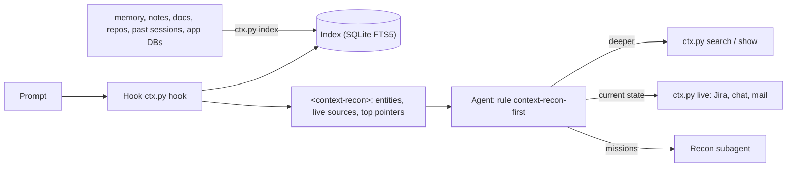

# 🧭 context

On by default. Every session gets its context first, without being asked: a local index
over everything the workspace knows, a prompt hook that hands the agent pointers for the
task at hand, and a rule that sets how deep to look before answering or acting.

## How it works

- **Index**: `kit/bundles/context/scripts/ctx.py index` reads local sources (Markdown and
  text, Claude Code transcripts, SQLite queries) into `~/.cache/agent-skeleton/context/`,
  one index per checkout so a worktree without your overlays never prunes them.
  Incremental by mtime and size; a full first run over tens of thousands of files takes
  about half a minute. The index stays on the machine; the pointers the hook adds (titles
  and snippets of notes, meetings, tickets) go to the model with the prompt, and `live`
  queries the services it names.
- **Hook** (`prompt_submit`, Claude Code and Gemini CLI): under half a second. Skips short or
  yes/no prompts (a prompt that names a ticket always counts), detects tickets and glossary entities, ranks hits by BM25, source
  weight and recency, keeps one per document and at most three per source, and remembers
  per session what it already showed. Starts a background refresh when the index is
  older than 30 minutes.
- **Live sources** are commands run on demand (`ctx.py live`), never indexed: Jira in the
  kit; chat and mail CLIs in your overlay.

## Rule and skill

| Item | Use it for |
|---|---|
| `context-recon-first` (rule, always) | Depth of recon per task (none, pointers, search plus repo docs plus live, deep subagent), trust order, the one-line "Context:" (in the reply language) opener, writing findings back |
| `context-recon` (skill) | Commands, source map, query recipes, the deep-recon subagent brief, tuning sources |

## Configuration

Sources and entities are TOML, merged in this order: `kit/bundles/context/sources.toml`,
every `local/bundles/<b>/context/sources.toml`, then `~/.config/agent-skeleton/context.toml`.
A later `[[source]]` with the same id replaces the earlier one, `extend = true` merges into
it (lists appended), `enabled = false` removes it. Kinds: `files`, `claude-sessions`,
`sqlite`, `command`. `ticket_prefixes` limits what counts as a ticket key. The header of
`sources.toml` documents every key.

`[[entity]]` entries (name, aliases, terms, skills, paths, jira, live, note) make the hook
name the right skill, repo, board and live sources when a client, product or person
appears in the prompt.

| Variable | Default | Effect |
|---|---|---|
| `CTX_HOME` | `~/.cache/agent-skeleton/context` | Index, lock, log and per-session state |
| `CTX_HOOK` | `on` | `off` disables the hook |
| `CTX_SOURCES` | unset | Config files (path list) that replace the discovery above |
| `CTX_NO_SPAWN` | unset | `1` never starts a background index run |
| `CTX_REFRESH_MIN` | `30` | Index age that triggers a background refresh |
| `CTX_CONFIG` | `~/.config/agent-skeleton/context.toml` | Extra personal sources |

## Tools without a prompt hook

Cursor's `beforeSubmitPrompt` cannot add context and Antigravity has no prompt event:
there the rule alone drives recon, and the agent runs `ctx.py brief "<task>"` itself.

## Dependencies

Python 3.11 or newer (for `tomllib`) with SQLite FTS5, which the python.org and Homebrew
builds include.
