# Mermaid diagrams

Load this before drafting any diagram: the conventions below keep every diagram in a
repository coherent and renderable on GitHub, in Markdown viewers, in PDF exports and
on mermaid.live.


> **Starting premise:** Mermaid is a text-based diagramming language. It excels at **block diagrams, flows, sequence diagrams, state machines, ER models, Gantts, and decision trees**. It is *not* a CAD or schematic tool: for symbol-accurate schematics or detailed wiring, use a dedicated tool and embed an image. This skill defines a shared visual language so diagrams across the repository look and read the same.

## 1. When to use each diagram type

| Need | Mermaid type | Why |
|------|--------------|-----|
| Linear pipeline / data flow (A → B → C) | `flowchart LR` | Directional, simple, easy to color |
| Functional blocks laid out in a grid | `block-beta` | Allows columns and manual placement |
| Decision tree / troubleshooting | `flowchart TD` | Vertical, branches, decision shape `{}` |
| Interactions between actors / services over time | `sequenceDiagram` | Lifelines + messages, supports notes/loops |
| Lifecycle, modes, status transitions | `stateDiagram-v2` | Compact, supports composite states |
| Data model / database schema | `erDiagram` | Entities, attributes, cardinality |
| Project timeline / roadmap | `gantt` | Tasks, dependencies, milestones |
| Code/journey across files or branches | `gitGraph` / `journey` | Specific to those flows |
| Physical layout (board, room, dashboard tiles) | `block-beta` with `columns` | Manual row/column placement |
| Tabular data (memory map, registers, pinout) | Markdown table | Mermaid adds no value |
| Timing/waveforms | external (WaveDrom) | Mermaid does not render waveforms |
| Schematic with >30 components and complex wiring | external (KiCad/Fritzing/SVG) | Document with table + link to the source file |

## 2. Standard color palette (always use this)

> **Rule:** once this palette is set, **do not introduce new colors** without reason. Keeping it identical across diagrams is what makes them readable at a glance.

| Concept | `fill` | `stroke` | `color` (text) | Use |
|---------|--------|----------|----------------|-----|
| **Primary / Highlighted** | `#ffffff` (white) | `#000000` (thick) | `#000` | Main subjects, focal nodes |
| **Input / Source** | `#ffe0b2` (light orange) | `#e65100` | `#000` | External inputs, sources, triggers |
| **Output / Sink** | `#b2ebf2` (cyan) | `#006064` | `#000` | Final outputs, sinks, exports |
| **Data / Storage** | `#bbdefb` (light blue) | `#0d47a1` | `#000` | Databases, buses, payloads |
| **Compute / Processor** | `#ffcdd2` (light red) | `#b71c1c` | `#000` | Services, workers, CPUs |
| **Event / Trigger** | `#fff59d` (yellow) | `#f57f17` | `#000` | Clocks, schedulers, events |
| **Control / Config** | `#c8e6c9` (light green) | `#1b5e20` | `#000` | Reset, control planes, configuration |
| **Auxiliary** | `#e1bee7` (lilac) | `#4a148c` | `#000` | Secondary tracks (audio, side-channels) |
| **Infrastructure / Boundary** | `#cfd8dc` (blue-grey) | `#37474f` | `#000` | Ground, network, environment |
| **OK / Pass** | `#a5d6a7` (green) | `#1b5e20` | `#000` | "Everything correct" branches |
| **FAIL / Suspect** | `#ef9a9a` (red) | `#b71c1c` | `#000` | "Failure found" branches |
| **Action** (manual step) | `#fff9c4` (pale yellow) | `#f57f17` | `#000` | Tasks the human/agent has to perform |
| **Test point / Probe** | `#ffffff` | `#000` with `stroke-dasharray` | `#000` | Measurement / inspection nodes |

Reusable `classDef` block (copy as-is at the start of each diagram):

```text
classDef primary   fill:#ffffff,stroke:#000000,stroke-width:3px,color:#000
classDef input     fill:#ffe0b2,stroke:#e65100,stroke-width:2px,color:#000
classDef output    fill:#b2ebf2,stroke:#006064,stroke-width:2px,color:#000
classDef data      fill:#bbdefb,stroke:#0d47a1,stroke-width:2px,color:#000
classDef compute   fill:#ffcdd2,stroke:#b71c1c,stroke-width:2px,color:#000
classDef event     fill:#fff59d,stroke:#f57f17,stroke-width:2px,color:#000
classDef control   fill:#c8e6c9,stroke:#1b5e20,stroke-width:2px,color:#000
classDef aux       fill:#e1bee7,stroke:#4a148c,stroke-width:2px,color:#000
classDef infra     fill:#cfd8dc,stroke:#37474f,stroke-width:2px,color:#000
classDef ok        fill:#a5d6a7,stroke:#1b5e20,stroke-width:2px,color:#000
classDef fail      fill:#ef9a9a,stroke:#b71c1c,stroke-width:2px,color:#000
classDef action    fill:#fff9c4,stroke:#f57f17,stroke-width:2px,color:#000
classDef probe     fill:#ffffff,stroke:#000000,stroke-width:1px,stroke-dasharray:4 2,color:#000
```

## 3. Shape conventions

Map each conceptual element to a recognizable Mermaid shape so the diagram is scannable even before colors:

| Element | Mermaid shape | Syntax |
|---------|---------------|--------|
| Service / component / module | thick rectangle | `API[Auth Service]` with class `primary` |
| External system / port / endpoint | hexagon | `EXT{{Stripe API}}` |
| Test point / observation node | small circle | `M1((metric))` with class `probe` |
| Decision (if / branch) | rhombus | `Q1{Token valid?}` |
| Storage (DB / cache) | cylinder | `DB[(Postgres)]` |
| Queue / buffer / topic | rounded rectangle | `Q(orders.topic)` |
| Document / artifact | trapezoid | `DOC[/report.pdf/]` |
| Bus / channel (many signals) | label with slashes | `BUS[/" event bus "/]` or a thick edge |
| Group / subsystem | `subgraph` | see the templates reference |
| Source (user, sensor, file) | cylinder or hexagon | `SRC[(user uploads)]` or `SRC{{webhook}}` |

## 4. Templates

Ready-to-use, styled templates for every type in section 1 (pipeline, block
architecture, decision tree, sequence, state, ER, Gantt, dashboard layout) live in
[references/templates.md](references/templates.md). Start from the closest one.

## 5. Style rules (best practices)

### Do

- **One dominant direction**: `LR` for linear flows, `TD` for trees. Don't mix.
- **Label every relevant edge** with what it carries: `-->|"JSON payload"|`, `-->|"+5V"|`, `-->|"events/s"|`.
- **Keep `classDef` at the bottom** of the block so the graph reads cleanly at the top.
- **Use `linkStyle` to color critical edges** by type (red power, orange clock, blue data, lilac aux, cyan output). Note: `linkStyle 0,1,2 stroke:#color` is indexed by the **order edges appear**.
- **Short uppercase IDs** (`API`, `DB`, `Q1`); the human label goes inside the brackets `[...]`.
- **`<br/>` for multi-line** content inside a node.
- **Width `:N`** in `block-beta` so a block spans multiple columns and conveys hierarchy.
- **Skeleton first, color second**: draft the graph in black and white first, then add colors. Adding color too early can hide topology errors.

### Don't

- ❌ Emojis inside nodes: they break rendering in GitHub. Use words (`OK` rather than ✅).
- ❌ Neon fills with no contrast against black text. Verify the section 2 light fills read clearly.
- ❌ More than **15 to 20 nodes** in one diagram: split into sub-diagrams.
- ❌ Curved edges with many crossings: if it happens, refactor with `subgraph` or switch to `block-beta`.
- ❌ Mixing languages in labels: keep the diagram in the same language as the surrounding doc.
- ❌ Using Mermaid for schematics or layouts with more than ~30 components and complex wiring: in that case, document with a table and link to the original (KiCad, Figma, draw.io, etc.).
- ❌ Unsafe characters in node or edge labels: they break older renderers. See section 5.1.

## 5.1 Label-safe characters (renderer compatibility)

> **Why this matters:** many viewers pin **older Mermaid** (e.g. mermaid 9.4.3 in the `vscode-markdown-pdf` PDF export, and some GitHub/Markdown renderers). A diagram that renders on mermaid.live can still fail there with a generic **"Syntax error in graph"**. The cause is almost always a special character inside a node or edge **label**, not the topology. Keep labels to a safe ASCII subset and these errors disappear.

**Characters to AVOID inside labels**, and what to use instead:

| Avoid in label | Why it breaks | Safe replacement |
|----------------|---------------|------------------|
| `~` (tilde) | misparsed in node text (silent killer, the most common cause) | `approx`, `near`, or drop it (`~72/mo` → `approx 72/mo`) |
| `(` `)` parentheses | confuse shape delimiters, esp. **inside edge labels** `-->|"...(...)..."|` | rephrase without parens (`retrieveContexts (free)` → `retrieveContexts free`) |
| `<` `>` and `<=>` `<->` | angle brackets read as tags/arrows even when quoted | spell it out (`<=> cosine` → `cosine distance`) |
| `·` (middot), `→` `←` `↔` (arrows), the em dash (U+2014) and other non-ASCII symbols | exotic glyphs not parsed reliably | `-`, `then`, `,`, or words |
| `$` `#` `&` `%` | parser-dependent; safe in some versions, not all | drop or spell out (`#26657` → `26657`, `$72` → `72 USD`) |

**Rules of thumb**
- **Keep node/edge labels to letters, digits, spaces, and `+ - , . : / _`**: these are reliably safe everywhere.
- **`<br/>` is the only markup** allowed inside a label. Nothing else HTML/markdown-like.
- If a label needs spaces or punctuation, **quote it** (`A -->|"my label"| B`, `N["My Node"]`), but quoting does **not** rescue `~`, parens, or angle brackets; remove those regardless.
- Put currency/approximation in **prose or tables, not in the diagram**: tables render `~`, `$`, `→` fine; diagrams do not.
- When several diagrams in a doc fail but one renders, **diff the labels**: the working one is your safe-character reference.

## 6. Recommended workflow for producing a diagram

```mermaid
flowchart LR
    A([1. Identify what<br/>you want to show]):::action
    B([2. Pick the type<br/>per section 1]):::action
    C([3. Skeleton:<br/>nodes + edges]):::action
    D([4. Apply classDef<br/>from section 2]):::action
    E([5. Label edges<br/>with payload/value]):::action
    F([6. Test render<br/>at mermaid.live]):::action
    G([7. Paste into .md<br/>inside triple backticks]):::ok

    A --> B --> C --> D --> E --> F --> G

    classDef action  fill:#fff9c4,stroke:#f57f17,stroke-width:2px,color:#000
    classDef ok      fill:#a5d6a7,stroke:#1b5e20,stroke-width:2px,color:#000
```



## 7. Canonical references

- General syntax: <https://mermaid.js.org/syntax/examples.html>
- Block diagrams: <https://mermaid.js.org/syntax/block.html>
- Sequence diagrams: <https://mermaid.js.org/syntax/sequenceDiagram.html>
- State diagrams: <https://mermaid.js.org/syntax/stateDiagram.html>
- ER diagrams: <https://mermaid.js.org/syntax/entityRelationshipDiagram.html>
- Gantt: <https://mermaid.js.org/syntax/gantt.html>
- Live editor: <https://mermaid.live>

## 8. Checklist before pasting a diagram into documentation

```
[ ] Diagram type matches section 1
[ ] Palette from section 2 applied (no new colors introduced)
[ ] Shapes from section 3 respected
[ ] Every relevant edge labeled with its payload/value
[ ] linkStyle applied to color critical edges
[ ] Labels use only safe characters per section 5.1 (no ~, parentheses, angle brackets, middots, arrows, em dashes, $ or #)
[ ] Rendered successfully at mermaid.live
[ ] Render verified in the TARGET viewer too (GitHub preview, or markdown-pdf / mermaid 9.4.3 if exporting PDF)
[ ] Text language matches the surrounding document, no emojis, no exotic characters
```
