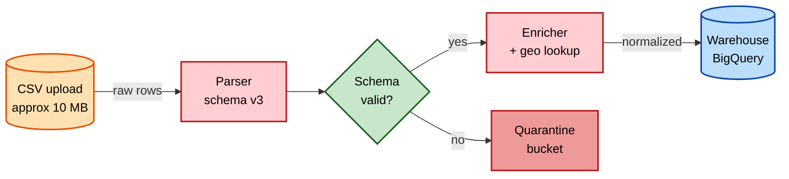
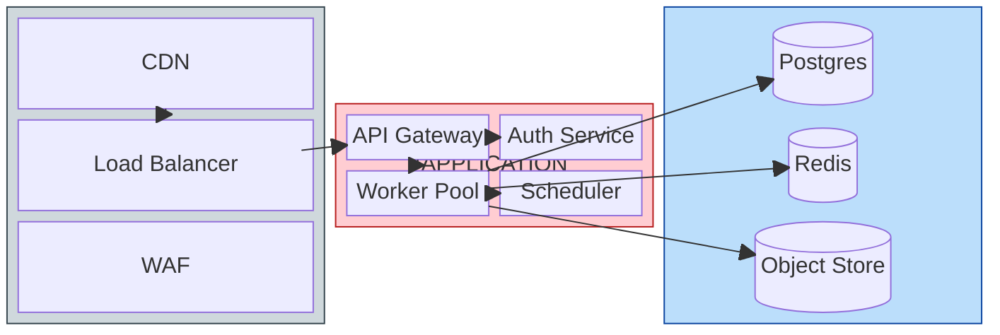
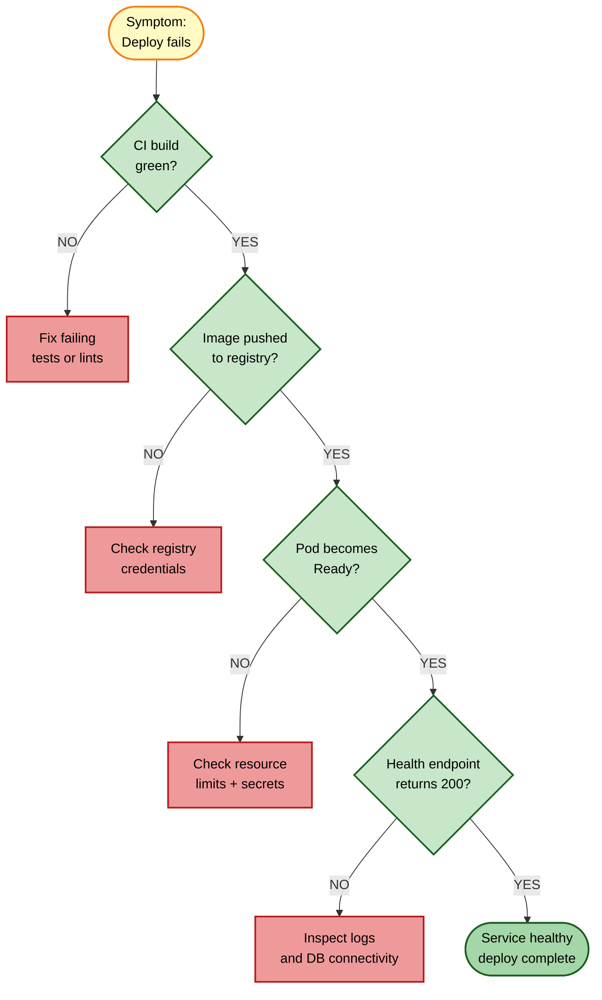
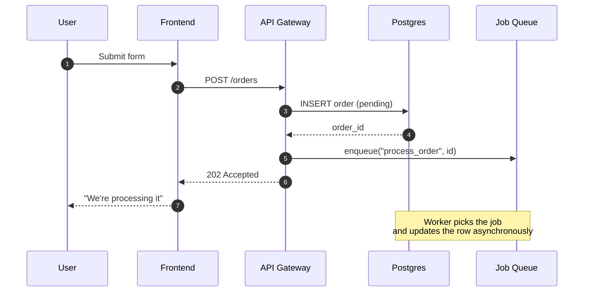
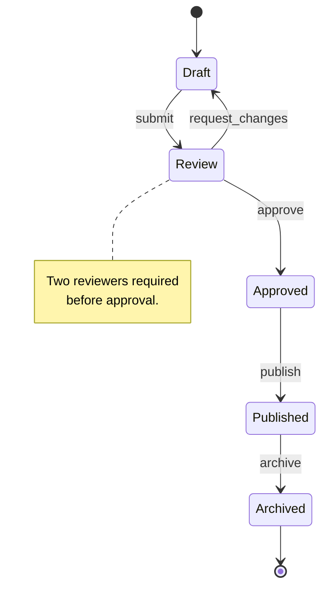
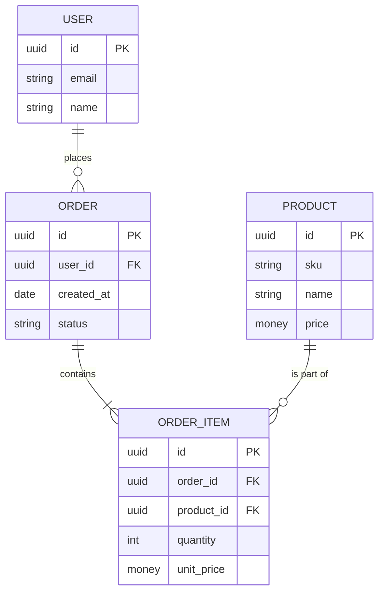
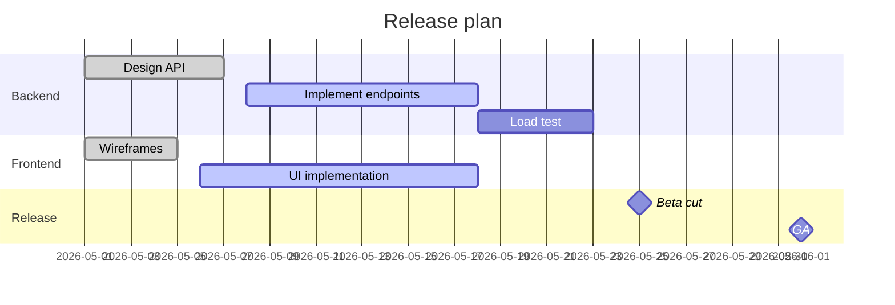
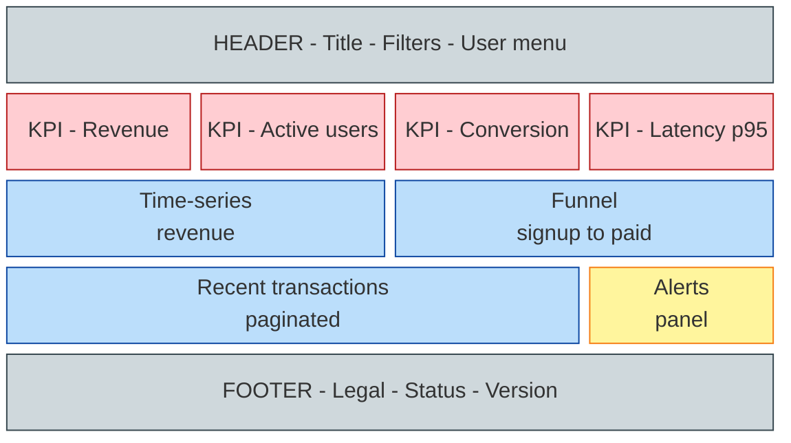

# Mermaid templates

Copy the closest template, keep the `classDef` lines, then replace the nodes. The
palette and shape rules are in the skill `docs-mermaid-diagrams`.

## 1 Linear pipeline (flowchart LR)

## 2 System architecture / functional blocks (block-beta)

## 3 Decision tree / troubleshooting (flowchart TD)

## 4 Sequence diagram (interaction across actors)

## 5 State machine (stateDiagram-v2)

## 6 Entity-Relationship (erDiagram)

## 7 Gantt / timeline

## 8 Physical / dashboard layout (block-beta positional)

