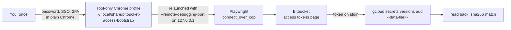

# bitbucket-access-bootstrap

Creates Bitbucket Cloud access tokens (repository, project or workspace) by driving the
Bitbucket web UI in a real Chrome, and stores each one in GCP Secret Manager of any
project. The token goes from the dialog to Secret Manager on stdin and is never printed.

The `git` bundle's `git-bitbucket-access-bootstrap` skill tells an agent when and how to
use it; this page is the tool's own reference.

## Why a browser

Bitbucket Cloud has no REST endpoint that creates an access token, for any of the three
kinds, and a token is shown only once, in the creation dialog. So creating one is a
dozen clicks and a copy-paste of a secret, which is where secrets leak (chat, shell
history, a notes file). The tool does the clicks and the copy, and checks the result.

## How it signs in (it doesn't)

Same model as the companion `gcp-oauth-bootstrap` tool:



- **`login`** opens your Google Chrome on a profile that belongs only to this tool, with
  no debugging port, so Atlassian and any SSO behind it see an ordinary browser. You
  sign in and close the window.
- Every other browser command relaunches that profile with a debugging port bound to
  `127.0.0.1`, attaches, acts and detaches. The window stays where it stopped.
- It is your Chrome binary but **not** your everyday profile.
- `stop` closes only the Chrome the tool launched (pidfile, checked against the profile
  path). It never kills by name or pattern.

> While the tool's Chrome runs with the debugging port, any local process could drive it.
> Run `bab stop` when you are done.

## Setup

macOS or Linux with Google Chrome and Python 3.11+.

```bash
tools/bitbucket-access-bootstrap/bin/bab install   # venv with Playwright; no browser download
tools/bitbucket-access-bootstrap/bin/bab login     # sign in, close the window
tools/bitbucket-access-bootstrap/bin/bab status    # "signed in: True"
```

Sign in with the Atlassian account that should own the tokens. `create` checks the
session first and stops with exit 7 when it is another account; the expected one comes
from `--expected-account`, else `BAB_EXPECTED_ACCOUNT`, `BITBUCKET_EMAIL` or `JIRA_EMAIL`
(environment, then `~/.config/agent-skeleton/atlassian.env`), as an email or an account
id. `status` prints both.

`gcloud` must be logged in with an account that can add secret versions in the target
project (`roles/secretmanager.secretVersionAdder`, plus `secretAccessor` for the
read-back).

## Use

```bash
bab=tools/bitbucket-access-bootstrap/bin/bab

# 1. Plan: read-only, no browser. Checks the account and that the secret exists.
$bab create --kind repository --workspace acme --repo web-app \
  --name cloudbuild-web-app-read --scopes repository,pullrequest --expires 2027-10-01 \
  --gcp-project my-project-id --secret-name bitbucket-web-app-read

# 2. Optional dry run in the browser: fill the form, snapshot, cancel.
$bab create ... --check-only

# 3. Do it.
$bab create ... --yes
```

```
token    created (cloudbuild-web-app-read)
git      user x-token-auth, commit email <bot-id>@bots.bitbucket.org
probe    OK  200 authenticated, target readable
store    projects/123456/secrets/bitbucket-web-app-read/versions/3 (read back, matches)
stash    removed
```

| Command | Does |
|---|---|
| `login [--url U] [--dry-run]` | plain Chrome on the tool profile, for a human sign-in |
| `start` / `stop` / `status` | Chrome with the debugging port; is the profile signed in |
| `snap [--url U] [--label L]` | screenshot, accessibility tree and URL of the tab (tokens redacted) |
| `list --workspace W [--repo R \| --project-key K \| --kind workspace]` | token names on that page |
| `create ... [--check-only] [--yes]` | plan, form check, or create + store |
| `push --stash FILE [--gcp-project P ...] [--yes]` | store a stashed token after a failed `create` |
| `verify --workspace W ... --gcp-project P [...] --secret-name S` | probe Bitbucket with the stored token, per project |

Pass `--expires YYYY-MM-DD` (after today, at most 365 days ahead): without it the
workspace default applies, which was 7 days on the workspace this was first run against.
Bitbucket ticks implied scopes itself (`pullrequest:write` also gives `repository:write`).

Kinds: `repository` (`--repo`), `project` (`--project-key`), `workspace` (Premium plan).
Scopes: `repository`, `repository:write`, `repository:admin`, `repository:delete`,
`pullrequest`, `pullrequest:write`, `webhook`, `pipeline`, `pipeline:write`,
`pipeline:variable`, `runner`, `runner:write`, `project`, `project:admin`.

Presets (`--preset`, extended by `--scopes`):

| Preset | Scopes | For |
|---|---|---|
| `read` | `repository` | clone and pull |
| `admin` | `repository`, `repository:write`, `repository:admin`, `pullrequest`, `pullrequest:write`, `webhook` | a Cloud Build repository connection, shared with Renovate |

[Renovate's Bitbucket Cloud docs](https://docs.renovatebot.com/modules/platform/bitbucket/)
list repository write and pull request write for its token (plus user and workspace read,
which only API tokens have); with pull request read alone it cannot open its PRs.

Account for gcloud, per project: `--account`, else
`kit/bundles/gcp/scripts/gcp-account.py <project>`, else (only with
`--use-active-account`) the active gcloud account.

`--gcp-project` repeats: one token, one version in each project's secret.

The secret should exist already (created by IaC, with its CMEK, labels and IAM). With
`--create-secret` the tool creates a missing one before it creates the token, with the
label `managed-by=bitbucket-access-bootstrap`:

| Flags | Replication | Key |
|---|---|---|
| none | automatic (global) | Google-managed |
| `--secret-locations europe-west1` | user-managed, those locations | Google-managed |
| `--kms-key projects/.../cryptoKeys/k` | user-managed, the key's location | that key (CMEK) |
| `--kms-key 'auto:*-cmek-europe-west1/secrets-cmek' --secret-locations europe-west1` | user-managed | the first key ring in the project matching the glob that holds that key |

Prefix a key with `PROJECT=` to apply it to that project only (repeatable); a bare key
applies to every project without its own entry. Match what the IaC declares: Terraform
replaces a secret whose replication differs, and the versions go with it. CMEK goes
through `--replication-policy-file`, because gcloud refuses `--kms-key-name` with
user-managed replication. `BAB_SECRET_LOCATIONS` and `BAB_KMS_KEY` set defaults.

Rotation: Bitbucket refuses a second token with the same name, so create the new token as
`<name>-YYYYMMDD` into the same secret, let consumers read `latest`, then revoke the old
token in the Bitbucket UI.

## How the value is protected

| Where | How |
|---|---|
| Screen | the result dialog is closed right after the value is read |
| Snapshots | `ATCTT`, `ATATT`, `ATBB` values are redacted from the text; the screenshot is skipped while one is on screen |
| Process list | gcloud gets the value on stdin (`--data-file=-`), never in argv or the environment |
| Terminal | never printed; every error message is scrubbed |
| Disk | a stash file (mode 0600, exclusive create, outside the repo) exists only between the dialog and a matched read-back, so a crash never loses the only copy |
| Secret Manager | the new version is read back and compared by SHA-256 before the stash is removed |

The value does sit in the tool's memory and is sent to `api.bitbucket.org` once as a
Bearer header for the probe.

## What `probe` and `verify` prove

| HTTP | Meaning |
|---|---|
| 200 | the token authenticates and can read the target |
| 403 | the token authenticates; its scopes do not include repository read |
| 401 | Bitbucket rejects it (wrong, revoked, expired; a new one is retried for ~30 s) |

## Exit codes

`0` ok or plan printed, `1` a step failed (a snapshot path is printed), `2` bad usage or
Playwright missing, `3` not signed in, `5` the token was created but Secret Manager failed
(kept in the stash), `6` a token with that name already exists, `7` the browser is signed
in as another account than the expected one (or the account could not be read).

## Where things live

| Path | Holds |
|---|---|
| `~/.local/share/bitbucket-access-bootstrap/chrome-profile/` | the Atlassian session |
| `~/.local/share/bitbucket-access-bootstrap/venv/` | Playwright |
| `~/.local/share/bitbucket-access-bootstrap/stash/` | a token in flight (normally empty) |
| `~/.local/share/bitbucket-access-bootstrap/runs/` | snapshots |

Override with `BAB_HOME`, `BAB_CHROME`, `BAB_CDP_PORT` (default 9340),
`BAB_PROFILE_DIRECTORY`, `BAB_ACTION_TIMEOUT_MS`, `BAB_PYTHON`, `BAB_GCLOUD`.

## Selectors

Bitbucket's markup changes without notice. Each control is found by role and accessible
name with fallbacks (scope checkboxes by input value, then by section group, then by the
section heading), and a step that finds nothing stops with a snapshot instead of guessing.
After a redesign, run `create --check-only` and read the snapshot's `aria.yaml` to adjust
`bab/bitbucket.py`.

## Tests

`python3 -m unittest tests.test_bitbucket_access_bootstrap` (or `bin/skeleton test`)
covers redaction, argument checks, the plan, the stash and the Secret Manager calls
against a fake gcloud. The browser steps need a signed-in profile and are checked with
`--check-only`.
