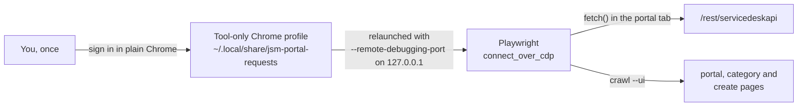

# jsm-portal-requests

Raises Jira Service Management requests through a customer portal as the person signed
in to a dedicated Chrome, and keeps a catalog of what each portal offers: categories,
request types and every field with its id, whether it is required and its options.

The `jira` bundle's `jira-service-desk-portal-requests` skill tells an agent when and
how to use it; this page is the tool's own reference.

## Why a browser session

A request to another team's desk (IT, people, finance) has to come from the person, as
a customer of that portal, and that is often an account with no API token: a portal-only
customer, or a second identity on the same site. The tool never handles a password. It
reuses the session of a Chrome profile the person signed in to once, and makes the REST
calls from inside that page, so Jira sees the same user the portal shows.



- **`login`** opens your Google Chrome on a profile that belongs only to this tool, with
  no debugging port. Sign in and close the window. A password saved in that profile's
  password manager keeps later logins to one click.
- Every other browser command relaunches that profile with a debugging port bound to
  `127.0.0.1`, attaches, acts and detaches.
- `stop` closes only the Chrome the tool launched (pidfile checked against the profile
  path). It never kills by name or pattern.

> While the tool's Chrome runs with the debugging port, any local process could drive it.
> Run `jpr stop` when you are done.

## Setup

macOS or Linux with Google Chrome and Python 3.11+.

```bash
tools/jsm-portal-requests/bin/jpr install   # venv with Playwright; no browser download
tools/jsm-portal-requests/bin/jpr login     # sign in, close the window
tools/jsm-portal-requests/bin/jpr status    # account of the session
```

Settings, environment first, then `~/.config/agent-skeleton/jsm-portal.env`:

| Key | Meaning |
|---|---|
| `JPR_SITE` | `your-org.atlassian.net`; falls back to `JIRA_SITE` in `atlassian.env` |
| `JPR_EXPECTED_ACCOUNT` | email or account id the session must belong to; `crawl`, `request --yes` and `comment --yes` stop with exit 7 otherwise |
| `JPR_HOME`, `JPR_CHROME`, `JPR_CDP_PORT` | state dir, Chrome binary, debugging port (default 9341) |

## Use

```bash
jpr=tools/jsm-portal-requests/bin/jpr

$jpr crawl                       # REST walk of every portal the account sees
$jpr crawl --portal 1 --ui       # also open each category and create page
$jpr portals
$jpr types 1                     # categories and request types
$jpr show 1 "Google group creation"

# Plan: prints every field, checks required ones, runs the text guard. Sends nothing.
$jpr request 1 "Google group creation" \
  --field "external group=External" --field "Group Name=team.example.users" \
  --summary "Access group for the example app" --description-file desc.txt
# Send.
$jpr request 1 "Google group creation" ... --yes

$jpr mine --all                  # requests this account raised
$jpr get PROJ-123                # one request with its public comments
$jpr comment PROJ-123 --file reply.txt [--yes]
```

| Command | Does |
|---|---|
| `login [--url U] [--dry-run]` | plain Chrome on the tool profile, for a human sign-in |
| `start` / `stop` / `status` | Chrome with the debugging port; account of the session |
| `snap [--url U] [--label L]` | screenshot and accessibility tree of the tab |
| `crawl [--portal ID ...] [--ui]` | write the catalog (JSON and one Markdown page per portal) |
| `portals`, `types P`, `show P T [--json]` | read the catalog |
| `request P T [--field K=V ...] [--yes]` | plan, then raise a request |
| `mine [--all]`, `get KEY` | follow requests |
| `comment KEY --text/--file [--yes]` | plan, then add a public comment |

`--field` takes a field id or the label shown in the portal (unique part is enough);
values: option labels or ids, `A; B` for multi-choice, `Parent > Child` for cascading
selects, account ids for user fields, `@file` for long text, `json:<raw>` for anything
else. Paragraph fields are Jira wiki markup on this API.

`request --yes` refuses when the account already has an open request of the same type
(exit 6) unless `--allow-duplicate` is given.

The catalog is in `~/.local/share/jsm-portal-requests/catalog/<site>/`; snapshots of the
UI walk are in `runs/`.

## Limits

- **Jira forms** (ProForma) are not reachable through the customer REST API. `crawl --ui`
  marks request types whose create page renders one, and `request` refuses them.
- No attachments: add them in the portal after the request exists.
- `crawl --ui` compares the create page's labels with the REST fields; radio option
  labels can show up as unmatched without meaning anything.

Exit codes: 0 ok or plan printed, 1 a step failed, 2 usage or incomplete request, 3 not
signed in, 5 blocked by the text guard, 6 an open request of that type exists, 7 the
session belongs to another account.
