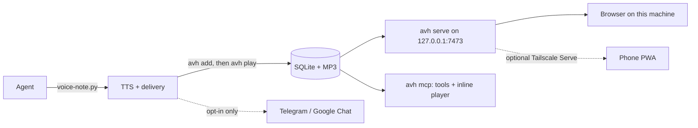

# Voice Hub

History and player for the spoken summaries your AI coding agents send (Claude Code in a
terminal or inside an editor, Cursor Agent, Cursor CLI, Gemini CLI, Antigravity, Codex).
Every note keeps its audio, its transcript, the text the agent wrote, which agent and
session produced it, and whether you have heard it. You play it at the speed you want,
on this machine or, optionally, on your phone.

It is the **default destination** of the kit's `voice` bundle (`NOTIFY_CHANNELS=hub` in
`~/.config/agent-skeleton/notify.env`): every note sent by
`kit/bundles/voice/scripts/voice-note.py` is stored here, the script prints a player link
the agent pastes into its reply, and the note starts playing, in a hub tab you already
have open or in a new browser tab (`VOICE_HUB_OPEN=auto|always|never`). Telegram and
Google Chat are opt-in extras of the bundle; nothing leaves the machine unless you list
them. If the server is down, `voice-note.py` says so in one line, with the command that
starts it, and exits 1.

```bash
tools/voice-hub/bin/avh service install       # a login service (macOS launchd), what setup offers
tools/voice-hub/bin/avh serve                 # or in the foreground (http://127.0.0.1:7473)
tools/voice-hub/bin/avh ping                  # is it up? exit 0 yes, 1 no (with the start command)
tools/voice-hub/bin/avh open                  # open the hub in the browser
tools/voice-hub/bin/avh list                  # recent notes, * = not heard yet
tools/voice-hub/bin/avh doctor                # check every dependency, one line each
```

## What you get

- **A player that respects your speed, and the voice.** 1x to 2.5x, remembered across
  notes and devices. Notes are synthesised at the natural rate and the player only
  speeds them up; it never slows a recording below the rate it was made at (slowed-down
  synthetic speech sounds metallic). A note recorded faster than 1x gets a
  "Re-record at natural speed" button (or `avh resynth`).
- **What the agent left for you, first.** A note's commands (fenced blocks in its text,
  `voice-note.py --command`, or anything the same agent session sent with
  `notify.sh --code`) and its short written explanation (`--brief`) open the detail
  view in a "For you" box, each command with its own copy button.
- **Links that play.** `/n/<id>?play=1` (what agents paste) starts the note. If a hub
  tab is already open, the server hands the note to it before the new tab even loads,
  and the new tab closes itself. Otherwise the new tab plays, or asks for one tap when
  the browser blocks sound. Scripts get the same hand-off without opening a tab:
  `avh play <id>` asks an open hub tab to play the note and reports whether one did,
  which is how `voice-note.py` decides between "it is already playing" and opening the
  browser.
- **A follow-along transcript.** The sentence being spoken is highlighted; tap any
  sentence to jump there. Timing is proportional to text length, labelled approximate.
- **Who said it.** Each note records the agent and where it ran ("Claude Code in
  Cursor", "Cursor CLI", ...), the repo, branch, folder and session id, detected from
  the environment; see [`avh/agents.py`](avh/agents.py).
- **Inbox behaviour.** Unheard dot, "Unheard" plays everything unheard oldest first,
  "Mark all as heard" (two taps), a ✓ on every card to mark one note heard or unheard
  without opening it, tap the wave of the playing note to seek from the list, resume
  where you left off, star, archive, search
  (text, ticket keys, projects), filters by agent and project.
- **Inside the agent chat.** An MCP server (`avh mcp`) gives agents tools to look notes
  up, and clients that render MCP Apps show `voice_note_play` as a player *inside the
  chat*.
- **Phone, optional.** Installable PWA over Tailscale HTTPS (`service install
  --tailnet`), lock-screen controls (Media Session), the last unheard notes cached on
  the phone, live updates (Server-Sent Events), an app badge with the unheard count.

## Architecture



- **Standard library only.** Python 3.9+ and `ffmpeg`. No pip, no npm, no build step.
- **Store:** one SQLite file (WAL) plus one MP3 per note (CBR 64 kbps mono, because the
  Chromium inside VS Code and Cursor has no AAC or Opus decoder). Data lives in
  `~/.local/share/agent-skeleton/voice-hub/`, created with mode 0700 (database 0600),
  never in git.
- **Server:** `ThreadingHTTPServer` on loopback only, single-range support (206/416),
  Host-header allow-list (DNS rebinding), an `X-AVH: 1` header on every write (CSRF),
  a strict CSP, and an SSE feed driven by SQLite's `PRAGMA data_version`.
- **Front end:** one HTML, one CSS and one JS file, plus a service worker.

## Commands

| Command | What it does |
|---|---|
| `avh serve [--port N]` | Run the server in the foreground |
| `avh add --audio F [--meta-json -] [--title ...]` | Store a note; prints its URL (`--json` for everything) |
| `avh update ID --channels-json '{...}'` | Record delivery results, retitle, mark heard |
| `avh list [-n 20] [--unheard] [-q text] [--json]` | Recent notes |
| `avh show ID` / `avh url ID\|last [--public]` | One note / its player URL |
| `avh open [ID]` | Open the hub in the default browser |
| `avh ping [--json]` | Is the server up? Exit 0 yes, 1 no (prints the command that starts it) |
| `avh play ID\|last [--wait S] [--json]` | Ask an open hub tab to play a note; exit 0 played, 1 no open tab, 2 server down |
| `avh service install [--tailnet]\|status\|restart\|uninstall` | macOS login service; `--tailnet` also runs Tailscale Serve |
| `avh resynth ID... \| --all [--limit N] [--dry-run]` | Re-record notes at 1x (costs TTS characters; `--dry-run` counts them) |
| `avh command add --code C [--label L] [--explanation E]` | Attach a command to this agent session's note (sent before or after it, within 30 min) |
| `avh doctor` | Health check |
| `avh mcp` | MCP server on stdio |
| `avh detect-agent` | Show which agent this shell belongs to |

The service runs from your kit checkout. After pulling a new version of the kit, run
`avh service restart`.

## Configuration

Optional `~/.config/agent-skeleton/voice-hub.env` (KEY=VALUE, mode 0600); environment
variables win.

| Key | Default | Meaning |
|---|---|---|
| `AVH_HOME` | `~/.local/share/agent-skeleton/voice-hub` | Data directory |
| `AVH_PORT` | `7473` | Loopback port |
| `AVH_PUBLIC_URL` | empty, set by `service install --tailnet` | Tailnet URL used in links for the phone |
| `AVH_TAILNET_PORT` | `8443` | HTTPS port on the tailnet |
| `AVH_DEFAULT_SPEECH_RATE` | `1.0` | Synthesis rate assumed when a caller does not say |
| `AVH_ALLOWED_LOGINS` | empty | Restrict tailnet users (`Tailscale-User-Login`) |
| `AVH_TICKET_LINKS` | empty | Ticket chips that link, e.g. `PROJ=https://your-org.atlassian.net/browse/` |
| `AVH_VOICE_NOTE` | the kit's `voice-note.py` | Used by "Re-record at natural speed" |
| `AVH_LAUNCHD_LABEL` | `com.agent-skeleton.voice-hub` | Label of the macOS login service |

## MCP

Declare it once in `skeleton.local.toml` and run `bin/skeleton init`:

```toml
[mcp.voice-hub]
command = "python3"
args = ["${SKELETON_ROOT}/tools/voice-hub/bin/avh", "mcp"]
```

Tools: `voice_notes_recent`, `voice_note_get`, `voice_note_play` (inline player via MCP
Apps, a link otherwise), `voice_note_mark_heard`, and the app-only
`voice_note_audio_chunk` the player uses to fetch the MP3 without touching the network.

## Phone (optional)

1. Install Tailscale on this machine and on the phone, signed in to the same tailnet.
   Keep it as an always-on VPN on the phone; some Android vendors also need
   *Unrestricted* battery usage for the browser and Tailscale.
2. `tools/voice-hub/bin/avh service install --tailnet`. It prints the tailnet URL (your
   machine's MagicDNS name on port 8443). Depending on your Tailscale setup,
   `tailscale serve` may need to run once with `sudo`.
3. Open that URL on the phone and *Add to home screen*.

## Tests

```bash
cd tools/voice-hub && python3 -m unittest discover -s tests -v
```

They use a temporary data directory and a free port: a hub already running on this
machine is never touched.

## Research notes

What was checked before building, and why the design is what it is:
[docs/research.md](docs/research.md).
